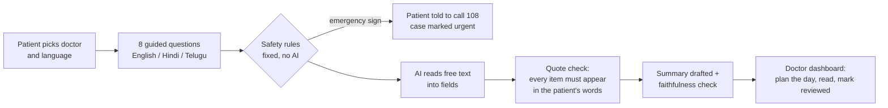

# Intakely

**Pre-visit intake for clinics, doctor by doctor.** Patients answer a few guided questions before the appointment. The doctor gets a short, checked summary, so consultation time goes to examination and treatment instead of routine questions.

> **Portfolio prototype. Synthetic data only. Not a medical device.** Intakely does not diagnose, give treatment advice or replace a doctor. Please do not enter real health information.

**Live demo:** _add your Render link_  ·  **Built by:** _Punith Sai, MSc Bioinformatics and Data Science_

---

## The problem

At the start of almost every consultation, the doctor asks the same basic questions: what is the problem, how long, which medicines, any allergies, any history. The patient is trying to remember it all under pressure, and the doctor spends valuable minutes collecting it. Intakely moves those routine questions to before the visit.

## How it works

1. **Patient:** enters name, age and language, chooses the doctor, and answers 8 short questions, one per screen.
2. **Safety first:** fixed rules look for emergency warning signs. If one matches, the patient sees a clear "call 108" message and the doctor sees the case marked urgent. This never depends on a model.
3. **AI organises, never decides:** a language model reads free-text answers into fields (duration, medicines, allergies) and drafts the summary paragraph. Each extracted item must quote the patient's own words, or it is dropped.
4. **Accuracy check:** a deterministic check compares the draft against the patient's answers. If it fails, a plain template summary is used instead, and the doctor can't mark the case reviewed while the check fails.
5. **Doctor:** signs in with an ID and PIN, sees today's patients, sets the order and minutes for each, reads the summary with the patient's answers beside it, and marks it reviewed.

## Features

- Three languages for patients: English, Hindi, Telugu
- Doctor-wise intake: patients choose who they are meeting; each doctor sees only their own patients
- Day planner: start time, minutes per patient, reorder, "urgent first"
- Reading flow for each case: summary first, patient's own answers under clear headings, accuracy check
- "Ask Intakely" help bot that answers questions about the site from a fixed FAQ (no medical advice)
- Contact form with honeypot and rate limit
- Runs with no API keys at all (rules and FAQ only); free Gemini and Groq keys optional

## Where AI is used, and where it is not

| Step | Who does it |
|---|---|
| Questions and wording in 3 languages | Fixed text (`app/content.py`) |
| Red-flag screening and the urgent message | **Rules only** (`app/rules.py`). A model may add a flag for the doctor, never remove one |
| Reading free text into fields | Model (Gemini, then Groq if it fails), JSON validated by Pydantic, each item must quote the patient |
| Writing the summary paragraph | Model drafts it; a faithfulness check must pass or the template is used |
| Marking a summary reviewed | Doctor only |
| Help bot | Model words answers from a fixed FAQ; medical and emergency questions get fixed replies |

## Tech stack

Python · Starlette + Uvicorn · Pydantic v2 · SQLite · itsdangerous (signed sessions) · plain HTML/CSS/JS front end · Gemini and Groq via OpenAI-compatible APIs (free tiers) · pytest

Intakely is an educational portfolio project. It is not a medical device, is not approved for clinical use, and must not be used to make medical decisions.
